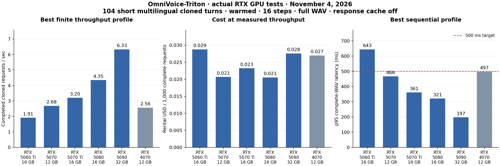
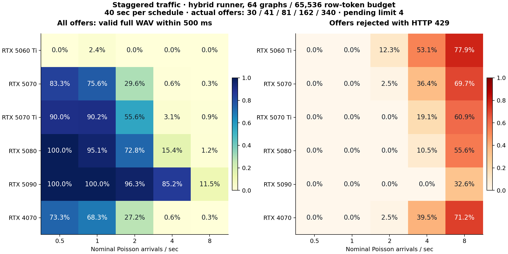

# OmniVoice-Triton RTX 50-series rental value — November 4, 2026

Actual TTS inference ran on **GeForce RTX 5060 Ti 16 GB, RTX 5070 12 GB, RTX 5070 Ti 16 GB, RTX 5080 16 GB, RTX 5090 32 GB and RTX 4070 12 GB**. Physical VRAM is from each card's `nvidia-smi`; visible memory is independently from PyTorch. All measurements are from November 4, 2026 UTC. The two Omnilingual judges ran separately on the RTX 5090 (32,607 MiB physical; 33,670,758,400 visible bytes; driver 595.84; CUDA 12.8). An additional 20-language Whisper diagnostic ran on Apple M5 Pro with 24 GiB shared unified RAM. Auditing, packaging and charts are CPU-only.

**The measured recommendation is conditional on latency.** RTX 5080 has the lowest cost per completed request among the tested settings. RTX 5070 and 5080 are effectively tied on throughput value: their cost difference is only 0.66%, which this single-host screen cannot reliably resolve. The 5070 is the cheaper entry point; the 5080 serves more traffic per card. RTX 5090 has the lowest warmed single-request latency. Among tested one-worker staggered profiles, RTX 5090 gives the highest nominal load per rental dollar while meeting the 500 ms p95 screen with zero rejections. These are rental-offer conclusions, not retail purchase rankings or universal GPU-family rankings. The 5080's fastest MPS setting remains a quality-review candidate: its observed throughput value does not establish quality preservation. The wider-cache single-worker change has the stronger paired preservation evidence.

| Actual GPU | Physical VRAM | Torch-visible bytes | SMs | Driver | Power limit |
| --- | --- | --- | --- | --- | --- |
| RTX 5060 Ti | 16311 MiB | 16,617,897,984 | 36 | 580.95.05 | 180.00 W |
| RTX 5070 | 12227 MiB | 12,346,195,968 | 48 | 595.99.02 | 250.00 W |
| RTX 5070 Ti | 16303 MiB | 16,608,788,480 | 70 | 595.91.07 | 300.00 W |
| RTX 5080 | 16303 MiB | 16,600,596,480 | 84 | 580.159.03 | 360.00 W |
| RTX 5090 | 32607 MiB | 33,670,758,400 | 170 | 595.84 | 600.00 W |
| RTX 4070 | 12282 MiB | 12,536,250,368 | 46 | 615.71.09 | 200.00 W |

The same locked runtime was used for all TTS cards: Python 3.12.3, Torch 2.8.0+cu128, CUDA 12.8, Triton 3.4.0, Transformers 5.5.4 and OmniVoice 0.1.4. CPU thread settings were OMP/MKL/OpenBLAS 8. The physical GPU UUID, complete CPU/cgroup description, library freeze and co-resident process evidence are retained per rental. No ASR or MuseTalk inference shared a GPU with timed TTS. The 5090's isolated ASR wheel install overlapped an early wide-cache warmup; its final install log timestamp was 22:29:00 UTC and the first timed C1 request began 22:29:14 UTC. Later ASR installation/downloads waited until all 5090 TTS stages ended. Warmup duration for that arm is not an isolated startup benchmark.

| GPU | Rental host CPU | Offer effective cores | Location | USD/hour incl.100 GB disk | Median initial clone registration ms |
| --- | --- | --- | --- | --- | --- |
| RTX 5060 Ti | Xeon® E5-2673 v4 | 10.0 | Quebec, CA | $0.198 | 96.1 |
| RTX 5070 | AMD Ryzen 7 3700X 8-Core Processor | 16.0 | Indiana, US | $0.200 | 59.9 |
| RTX 5070 Ti | Xeon® E5-2680 v4 | 28.0 | South Korea, KR | $0.268 | 80.7 |
| RTX 5080 | AMD Ryzen Threadripper 3970X 32-Core Processor | 32.0 | Australia, AU | $0.321 | 48.8 |
| RTX 5090 | AMD EPYC 7402 24-Core Processor | 16.0 | Mexico, MX | $0.628 | 59.2 |
| RTX 4070 | AMD EPYC 7F52 16-Core Processor | 16.0 | Colorado, US | $0.249 | 71.9 |

Prices are the accepted Vast offers, rather than a general market guarantee. Transport is local HTTP on each rented server. WAN/control-plane routing, upstream speech recognition/LLM work and MuseTalk require their own latency budgets; the Australia and Korea rentals were not measured as Chicago-to-GPU application paths. Provider host CPU performance and driver versions differ, so this is a comparison of usable rental systems, not an isolated causal architecture experiment.

All cards used the AhmadAFS1/omnivoice-triton `max-concurency` branch at **b7cced4a0274f18aca541f7837c490bb81d8744e**, with identical 24 product Python files and the checkpoint `k2-fsa/OmniVoice` revision `c5fdb5ccb189668d56333f77ba2629f4cd7535f4`. The product archive SHA256 is `a1de5675d138983472efd6028e01ec2ee0241730b81675d51161e71b0974fc0f`. No product/kernel source or deployment default was changed by this experiment. The tested speedup is a serving configuration already supported by the branch. Both `triton` and `hybrid` are OmniVoice-Triton runners: hybrid adds CUDA Graphs to the Triton patches.

Every timed generation used a full cloned reference, 16 steps, FP16 backbone, speed 1, denoise on, postprocessing off, codec batch 1 and sentence splitting off. Generated-response caching and response coalescing were disabled. The 9 original Aoede reference clips were registered before timing; these are 9 clips of the same source voice, not 9 independent speakers. The English reference remains 13.931 seconds. Many routes use a declared cross-language reference. A prepared `prompt_id` reuses reference preparation while every response still executes cloned TTS inference. New-voice upload/preparation and first-use registration are additional costs. The 16-step profile is held constant; it is not evidence that 16 steps match a 32-step default in quality.

The workload is 104 short published-text cases, one per Lingua route, with source/license and language-mapping caveats preserved. It represents short speech turns rather than long narration or thousands of unique voices. Each process receives a startup seed; concurrent/batched workers do not share a per-request RNG stream. Every measured response is a complete 24 kHz mono WAV. Per-request latency runs from dispatch to receipt of the complete body. Waveform decoding, hashing and file writes occur outside timing.

The closed-loop matrix uses 104 requests per phase: one eager worker at batch limits 1/8 and concurrency 1/8/32; two ordinary workers and two verified MPS workers at batch limit 1/concurrency 2/8/32; a one-worker MPS control; and hybrid runners with 8 graphs/16,384 row tokens or 64 graphs/65,536 row tokens at batch limits 1/8 and concurrency 1/8. Closed-loop concurrency means clients replenish completed requests; it is not a simultaneous 104-request burst. Separate staggered tests use common seeded Poisson schedules, 40 seconds each at nominal 0.5/1/2/4/8 arrivals/sec, with actual offer counts 30/41/81/162/340, first arrival at 0, batch limit 1 and pending limit 4. Arrival-to-complete timing includes dispatch lateness. HTTP 429 rejections remain in every offered-load denominator.

The following table selects the highest finite throughput observed for each card. Its tail latency is shown because throughput and individual response time are different objectives. One-second counts are from actual aligned completion bins, not throughput rounded into a first-second promise.

| GPU | Best tested mode / phase | Complete req/s | 104-request wall s | Request p95 s | USD/1,000 valid | First second / peak aligned 1 s |
| --- | --- | --- | --- | --- | --- | --- |
| RTX 5060 Ti | `dual-mps` / `dual-b1-c32` | 1.911 | 54.43 | 17.34 | $0.02875 | 0 / 3 |
| RTX 5070 | `dual-mps` / `dual-b1-c2` | 2.684 | 38.74 | 0.83 | $0.02066 | 2 / 4 |
| RTX 5070 Ti | `hybrid-wide` / `b1-c8` | 3.204 | 32.46 | 2.61 | $0.02322 | 3 / 4 |
| RTX 5080 | `dual-mps` / `dual-b1-c8` | 4.347 | 23.93 | 2.23 | $0.02052 | 4 / 5 |
| RTX 5090 | `results` / `b8-c32` | 6.328 | 16.43 | 5.42 | $0.02756 | 2 / 12 |
| RTX 4070 | `dual-mps` / `dual-b1-c32` | 2.561 | 40.62 | 12.97 | $0.02696 | 2 / 4 |

The matched sequential eager 5070 is 6.8% faster than the 4070. At these offers and each card's best tested serving setting, the 5070 costs 23.4% less per completed request. A 5080 price of approximately $0.323/hour would tie the observed 5070 throughput value; the actual 5080 offer was $0.321/hour. Small price/host changes can reverse their ordering. The 5090's best throughput costs $0.02756/1,000 requests; its stronger reason for voice calls is latency headroom.

The next table holds batch limit 1 fixed for the graph comparison. The staggered columns identify the highest sampled nominal rate with at least 95% of **all offers** returning a valid full WAV within 500 ms and with zero rejections. Each row is a short screen, not statistical or production p95 certification. Staggered two-worker MPS was not tested and could change a call-capacity ranking.

| GPU | Eager C1 p95 ms | 64-graph C1 p95 ms | 64-graph C1 req/s | Passing staggered nominal req/s | Passing arrival p95 ms |
| --- | --- | --- | --- | --- | --- |
| RTX 5060 Ti | 1002 | 647 | 1.748 | none in tested rates | — |
| RTX 5070 | 470 | 466 | 2.436 | none in tested rates | — |
| RTX 5070 Ti | 729 | 361 | 3.123 | none in tested rates | — |
| RTX 5080 | 361 | 321 | 3.634 | 1 | 487 |
| RTX 5090 | 450 | 197 | 5.488 | 2 | 449 |
| RTX 4070 | 506 | 497 | 2.312 | none in tested rates | — |

On the 5090, the 8-graph B1 arm made 279 captures and 271 evictions across warmup plus timed work. There are 64 distinct shapes in this short corpus. With 64 graph slots and 65,536 row tokens, all 64 fit; the B1 arm has zero timed recaptures/evictions. Matched C1 throughput increases 2.266→5.488 requests/sec and p95 full-WAV latency falls 450→197 ms. GPU busy time rises 39.8%→88.1%, with mean framebuffer use increasing 3,248→6,535 MiB. This is a concrete way extra VRAM helps: retaining useful graphs removes repeated capture and CPU launch work. Unseen text/reference lengths can introduce new shapes; the measured result assumes the tested warmup and finite shape set. The row-token policy is a memory heuristic with runtime headroom checks, not a strict VRAM partition.

| GPU | One wide-cache worker GPU busy | Mean VRAM MiB | Mean power W | Two MPS workers GPU busy at C8 | Two MPS mean VRAM MiB |
| --- | --- | --- | --- | --- | --- |
| RTX 5060 Ti | 96.0% | 6071 | 156 | 98.7% | 5609 |
| RTX 5070 | 96.9% | 6162 | 212 | 99.2% | 5748 |
| RTX 5070 Ti | 92.6% | 6194 | 242 | 75.4% | 5854 |
| RTX 5080 | 93.3% | 6229 | 271 | 96.3% | 5922 |
| RTX 5090 | 88.1% | 6535 | 414 | 67.3% | 6538 |
| RTX 4070 | 95.7% | 6419 | 193 | 98.5% | 5304 |

Two workers can improve throughput when they cover each other's CPU/launch gaps. On the 5090, two ordinary eager workers reach about 4.53 req/s, but one wide-cache worker reaches 5.68 req/s at C8. On the 4070, two ordinary workers reach about 2.19 req/s and verified MPS raises that to about 2.56 req/s. More free VRAM therefore does not imply spare compute. GPU-utilization percent is busy time rather than theoretical FLOP utilization; memory-utilization percent is memory activity rather than bandwidth saturation. Per-phase CPU/RSS samples for one/two MPS workers are in the derived audit; RSS sums can double-count shared pages.

Architecture research explains a plausible 50-series advantage without treating advertised AI TOPS as this workload. NVIDIA lists 5070 versus 4070 bandwidth 672 versus 504 GB/s and L2 cache 48 versus 36 MB. Dense FP16/BF16 Tensor throughput with FP32 accumulation is 61.7 versus 58.3 TFLOPS, only about 6% higher. FP4 sparse TOPS describe a different arithmetic recipe; this FP16 experiment does not automatically gain their advertised multiplier. [NVIDIA RTX Blackwell architecture, table 6](https://images.nvidia.com/aem-dam/Solutions/geforce/blackwell/nvidia-rtx-blackwell-gpu-architecture.pdf).

Consumer RTX 50 cards are compute 12.0; data-center Blackwell10.0 features and memory systems should not be assigned to them by name. [NVIDIA tuning guide](https://docs.nvidia.com/cuda/archive/12.8.1/blackwell-tuning-guide/index.html). Graph replay reduces repeated CPU submission overhead, which fits the measured 5090 improvement. [PyTorch CUDA Graphs](https://docs.pytorch.org/docs/main/notes/cuda.html). MPS permits concurrent scheduling across client processes when resources allow it. [NVIDIA MPS architecture](https://docs.nvidia.com/deploy/mps/architecture.html).

Separate English-clone diagnostics use two warmups and five synchronized full-model repetitions per B1/B8, then separate shape collection and separate profiler runs. Instrumented kernel times are not API timings. The trace is dominated by backbone GEMMs and attention; 5090 B1 contains about 17,199 kernels, with GEMM accounting for about 58% of kernel time. Current traces include CUTLASS/attention implementations labeled sm80; they do not demonstrate use of FP4 or a new Blackwell-only tensor instruction path. Such names identify implementation templates, not a different physical GPU. The model's iterative generation dominates host stage timers; prompt lookup, WAV encoding and codec decode are much smaller for these short turns.

| Actual GPU | Unprofiled model B1 mean ms | Traced kernels | Traced kernel sum ms | GEMM share of kernel time | Synthetic copy GB/s |
| --- | --- | --- | --- | --- | --- |
| RTX 5060 Ti | 851.7 | trace unavailable | — | — | 387 |
| RTX 5070 | 399.4 | 17183 | 390.0 | 54.6% | 581 |
| RTX 5070 Ti | 686.4 | 17183 | 294.0 | 56.0% | 768 |
| RTX 5080 | 339.0 | 17183 | 250.4 | 52.7% | 819 |
| RTX 5090 | 427.2 | 17199 | 171.6 | 58.3% | 1528 |
| RTX 4070 | 425.0 | 17161 | 411.5 | 60.8% | 461 |

Synthetic copy reads and writes 128 MiB tensors, exceeding L2; it is not a model DRAM-counter measurement. Synthetic FP16 GEMMs at observed dimensions and 4096 cubed are also retained. The 5060 Ti profiler reported `CUPTI_ERROR_INVALID_DEVICE` and returned no CUDA kernel events, causing the initial diagnostic helper to stop; a separate retry preserved the unavailable-trace status and completed model/shape/thread/microbench diagnostics. No host permission changes were attempted. Its inference measurements are valid GPU runs, while kernel attribution remains unavailable.

Quality was checked separately from performance. The wider-cache optimization preserves **624/624 baseline/after WAV pairs byte-for-byte**, 104 per GPU. Its generated audio is unchanged on the tested corpus. Both local Meta `omniASR_CTC_1B_v2` and `omniASR_LLM_Unlimited_1B_v2` screened 1,872 generated logical cases plus 9 reference clips, across all 104 declared routes. They ran sequentially in a separate environment, float32, batch 1, source commit 81f51e224ce9e74b02cc2a3eaf21b2d91d743455, with complete weight/tokenizer hashes. Identical waveform/language inputs reuse transcripts within each shard: actual model inferences are 1,255 for CTC and 1,255 for LLM. Reference text never enters either recognizer. [Omnilingual source and model documentation](https://github.com/facebookresearch/omnilingual-asr).

| TTS GPU | Baseline/graph byte-identical | Baseline both-judge exact chars /104 | Throughput both-judge exact chars /104 | Baseline LLM weighted CER | Throughput LLM weighted CER |
| --- | --- | --- | --- | --- | --- |
| RTX 5060 Ti | 104/104 | 20 | 27 | 13.1% | 12.0% |
| RTX 5070 | 104/104 | 22 | 20 | 13.2% | 11.9% |
| RTX 5070 Ti | 104/104 | 19 | 24 | 13.3% | 12.8% |
| RTX 5080 | 104/104 | 18 | 19 | 12.5% | 19.4% |
| RTX 5090 | 104/104 | 20 | 22 | 16.9% | 16.6% |
| RTX 4070 | 104/104 | 24 | 18 | 15.9% | 12.1% |

Absolute multilingual quality remains unqualified. On the 5080 MPS throughput arm, CTC weighted CER rose 32.5→35.3% and LLM CER 12.5→19.4%. All three recognizers transcribed its English sample with “aside” where the baseline and expected script use “inside”. The different RNG streams prevent attributing this change to MPS alone, but it is sufficient to withhold a quality-preservation claim for that setting. The [baseline sample](../benchmark/rtx50-series-value-2026-11-04/samples/rtx-5080-baseline-en.wav) and [MPS sample](../benchmark/rtx50-series-value-2026-11-04/samples/rtx-5080-throughput-en.wav) are retained for review. These strict ASR screens flag many baseline cases, and the two variants share a model family. Even the 9 reference clips produce 5 review flags, so ASR mismatch must not be reported as a verified TTS failure rate. CER is character-weighted; word error rates are not comparable across scripts without spaces. The additional cached Whisper model independently screens 20 exactly supported standard languages, 240 logical baseline/throughput cases, on Apple M5 Pro; it supplies a narrower cross-check rather than 104-route coverage. The other 84 routes have no Whisper clearance. Neither ASR establishes speaker identity, native pronunciation or MOS. Twi retains its declared Akan proxy, and dialect/script/source caveats remain attached to individual cases. Throughput-arm RNG streams differ from the baseline; their per-language gains and regressions are documented rather than described as a deterministic quality improvement.

Across the six GPUs there were **26,124 timed offers**, 7,488 warmup offers and **27,946 locally verified load WAVs**, plus profiler samples. Timed HTTP counts are 20,458 HTTP200 and 5,666 HTTP 429. All accepted 200 responses pass decoding, finite-signal, non-silence and sample-rate checks, and source execution counters match actual successful inference members. Rejections are explicit overload outcomes, not successful low-latency replies. The full raw responses, all generated audio, logs, shapes and traces remain in `/Users/ahmadsmacair/code/lingua/lingua/work/omnivoice-50series-value-2026-11-04/retained`. The Git evidence bundle includes losslessly compressed metadata/traces, 54 representative generated WAVs, complete scripts, all word checks and SHA manifests; original conditioning clips and checkpoint weights are excluded.

All 8 task-created contracts, including 2 failed-start rentals, are deleted with API absence verified. Local size and SHA256 checks completed before deleting each productive rental. The estimated compute-plus-allocated-storage lease total is $2.145; it includes provisioning and the separate ASR host lifetime, but excludes network charges/provider adjustments and is not an invoice. Failed-start contracts and actual test/cleanup timestamps are retained. The finite cleanup guard remained scoped to this task.

The next optimization target is avoiding shape churn and choosing efficient FP16 GEMM/attention implementations on sm120, with identical-output or paired word checks. A controlled runtime/kernel comparison, longer turns, many unique references, cold voice preparation and staggered two-worker MPS should precede a broad production promise. The tested 64-graph configuration is reviewable on `max-concurency`; deployment defaults and production servers were not changed.

For fleet planning, active calls convert to TTS arrivals through `calls × speech turns per call per second`; simultaneous bursts are a separate load. A 1,000-request burst completed in 2 seconds would require 500 complete requests/sec. Dividing by the fastest 6.33 req/s finite screen already gives a planning estimate of approximately 80 equivalent GPUs before latency headroom, assuming that observed per-GPU throughput scales linearly. That is a capacity calculation, not a measured fleet result. This experiment provides no evidence for 1,000 fresh cloned full-WAV requests in 1–2 seconds on a single 4070/5070.

The full [evidence index](../benchmark/rtx50-series-value-2026-11-04/README.md), [capacity CSV](../benchmark/rtx50-series-value-2026-11-04/derived/capacity.csv), [audio manifest](../benchmark/rtx50-series-value-2026-11-04/samples/manifest.json) and [publication integrity manifest](../benchmark/rtx50-series-value-2026-11-04/publication-manifest.json) make the figures inspectable. Published text fixtures retain the FLORES CC-BY-SA4.0, Omnilingual corpus CC-BY4.0 and individual Wikipedia-source notices already attached to the original corpus; code retains the repository license.
